# QueueLess

**Skip the queue. Grab your food.** A pre-ordering app for a college canteen: order from the classroom, pick a pickup time, and walk up when the food is ready.

Built by **Vansh Dave** (backend) and **Swara Tillu** (front end), B.Tech Artificial Intelligence students at MPSTME Mumbai.

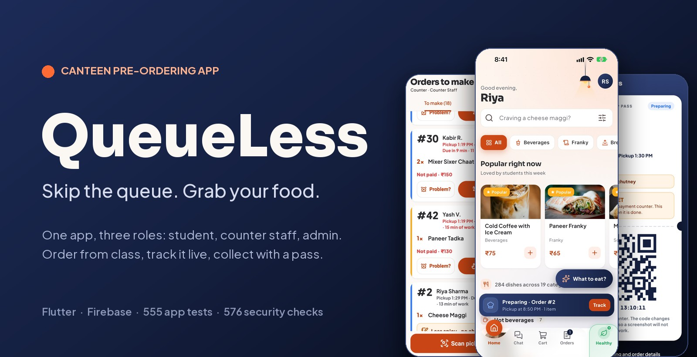

> **Status, stated plainly.** QueueLess is built and tested, and loaded with a real canteen menu of 284 dishes. It has not been used by real students yet, so nothing on this page claims a time saving. A four-week pilot is the next step.

## Why we built it

At our college, a break starts and everyone reaches the canteen at the same moment. You stand in one line to pay, then wait again for the food. Behind the counter, orders, money and cooking all begin at once.

We read that as a problem of timing more than of speed. So the whole project comes down to one question:

**What if the order reached the kitchen before the student reached the counter?**

Then the counter has one job left: hand over food that is already made.

## How one order moves

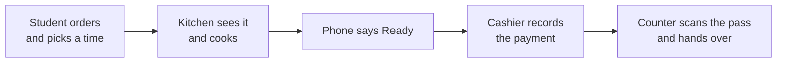

An order only moves forward. Only the cashier can mark it paid. Only a paid order can be handed over.

## One app, three roles

The same app shows three different apps, depending on who signs in. The split is enforced by the database, not by hiding buttons.

### Students

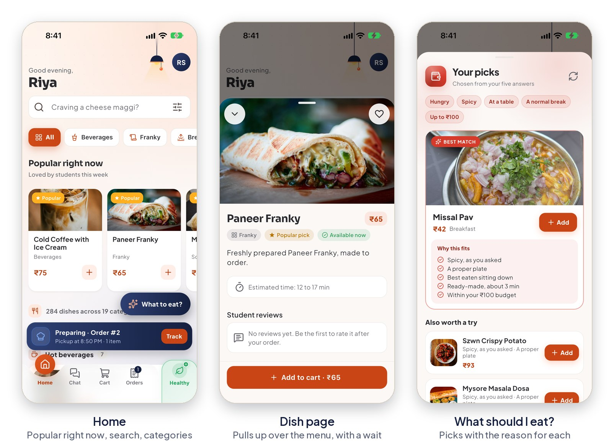

- The whole menu with photos, search, and no-egg and Jain filters.
- "Popular right now", ranked from what is being ordered at this time of day.
- A wait estimate on every dish.
- A five-question "What should I eat?" quiz that explains each pick.

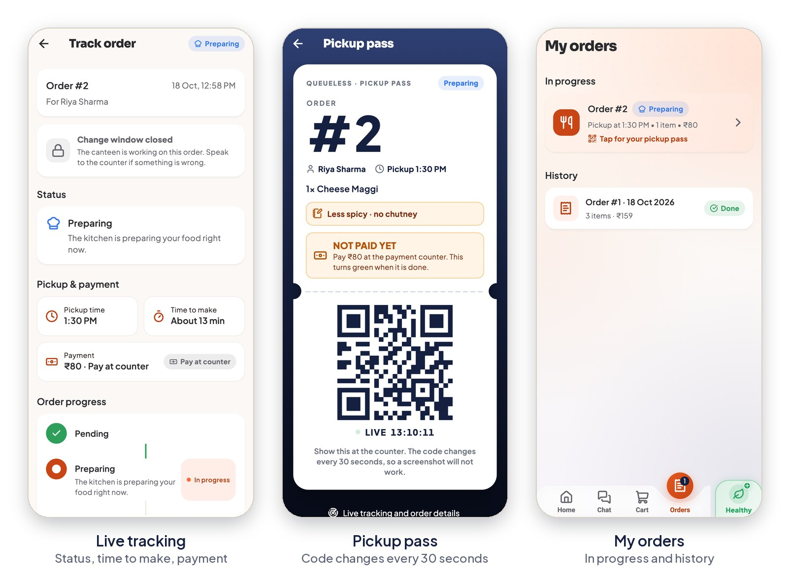

- Pickup times that show how busy the counter will be.
- Live status and a chime when the food is ready.
- A pickup pass whose QR code changes every 30 seconds, so a screenshot is useless.
- Sixty seconds to change or cancel after ordering.

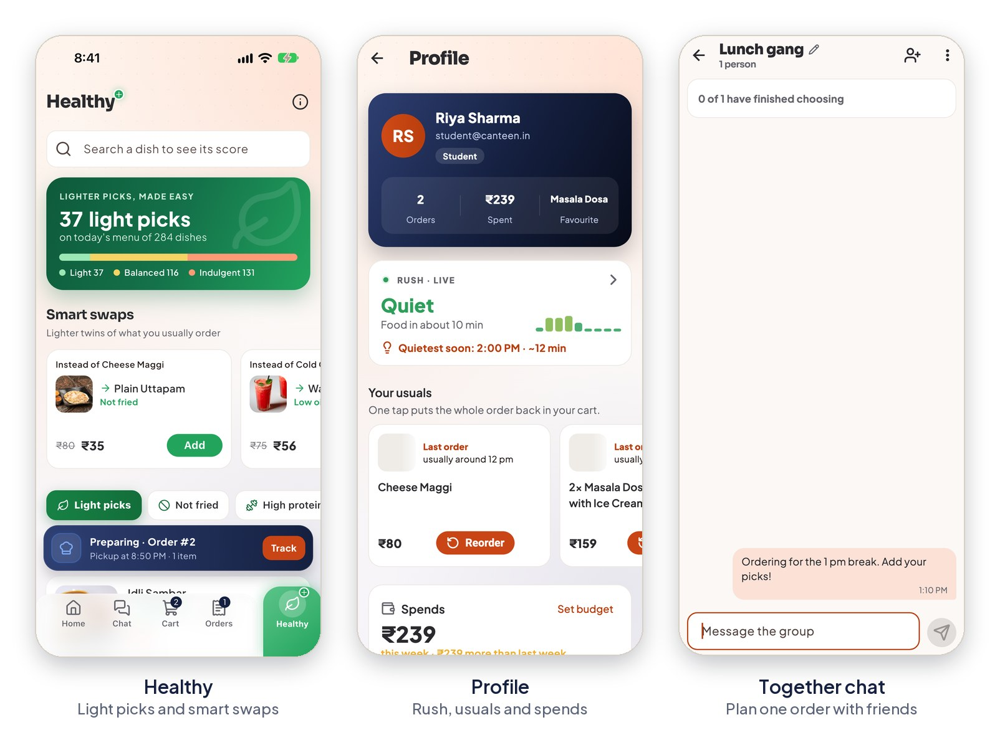

- A Healthy section with lighter swaps, and the reason shown for every score.
- Usual orders back in the cart in one tap, plus a weekly spend and budget.
- Breaks read from a photo of the class timetable (on iPhone), so an order can be planned for the next one. The photo is read on the phone and not kept.
- Together: a group chat where friends plan one order.

### Counter staff

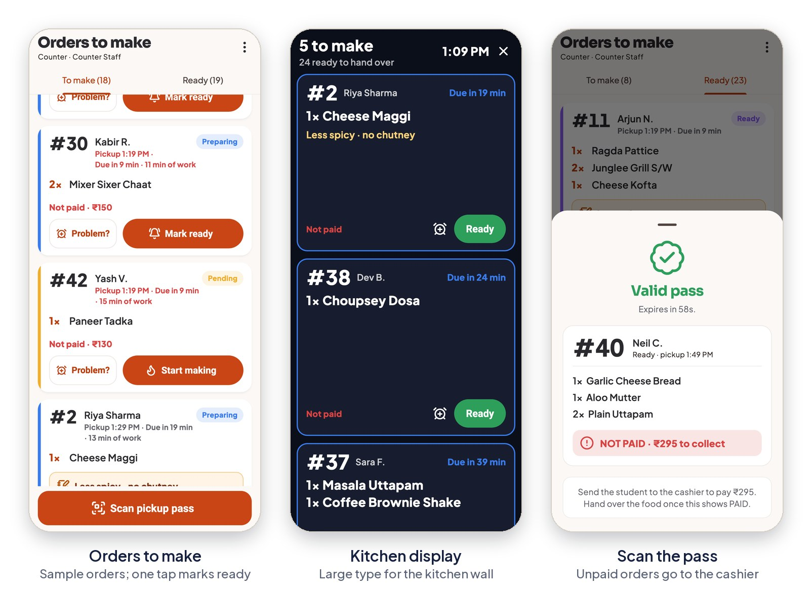

- One list of what to cook, with daily order numbers and the student's note.
- "Not on our menu" for a dish the canteen does not make; the admin switches it off in one tap.
- Three actions to learn: mark ready, scan, hand over.
- "Running late" and "dish not available" in one tap.
- Screens in English, Hindi or Marathi.

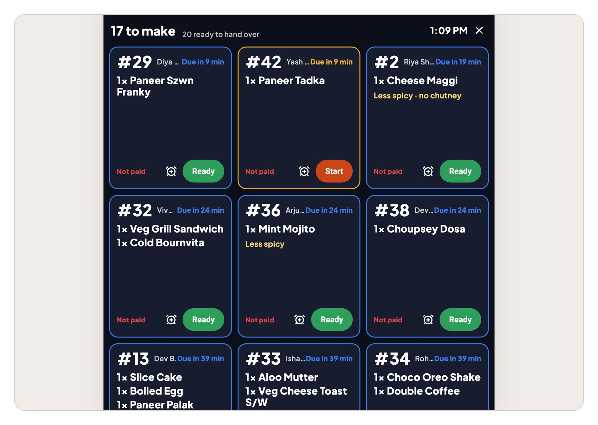

A large-type kitchen display, readable from across the kitchen.

### The admin, who is the cashier

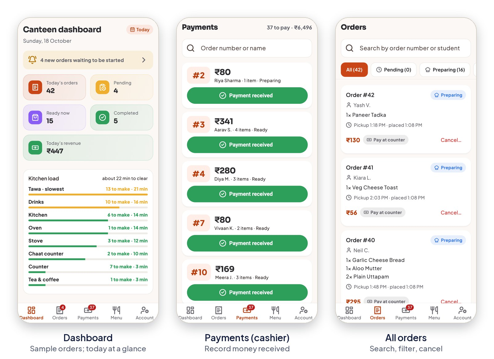

- The day on one screen, including the load on each kitchen station.
- A Payments tab: one tap records "payment received" and the student's pass turns to PAID.

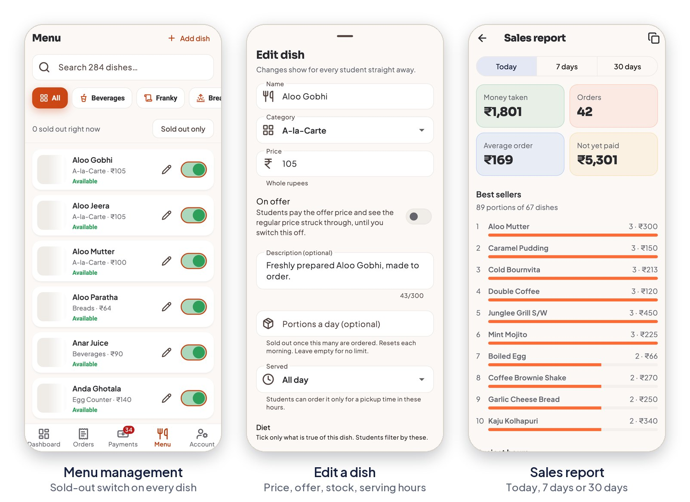

- The canteen runs its own menu: price, sold out, offers, portions a day, serving hours.
- A sales report for today, the last 7 days or the last 30.
- Staff accounts, with a staff ID login for anyone who has no email, plus opening hours, problem reports and catering requests.
- New dishes start switched off, so nothing reaches students before the canteen turns it on.

### The TV order board

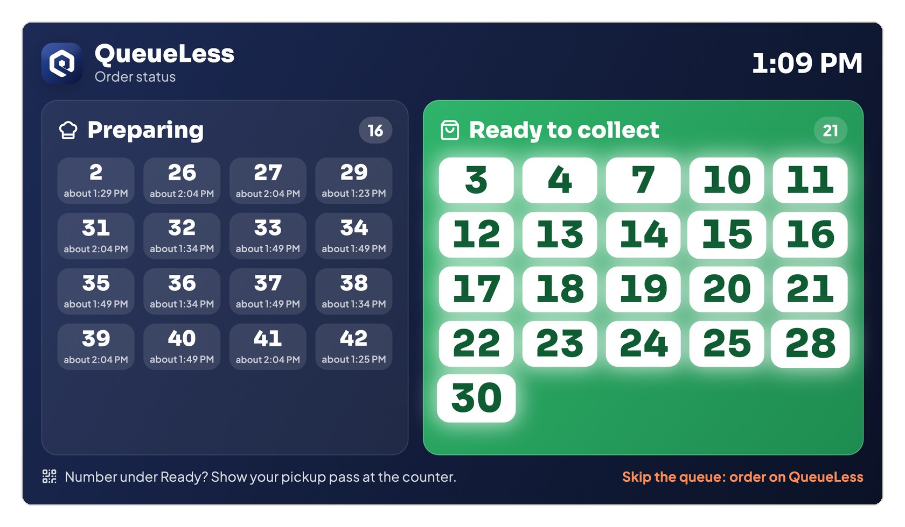

A TV by the counter shows the numbers being made, with about when each will be ready, and the numbers ready to collect. Numbers only: no names, no dishes, no sound. It runs on its own login, made by the admin, which can change nothing.

## What is working, and what is not

| | Status |
| --- | --- |
| Ordering with payment at the counter, live tracking, pickup pass | Built and tested |
| Counter screens, kitchen display, pass scanner | Built and tested |
| Cashier, menu and stock control, hours, offers, staff accounts, sales report | Built and tested |
| Group chat, catering requests for campus events, late pickup | Built and tested |
| TV order board, staff ID logins, menu safety | Built and tested |
| Online payment by UPI or card | Written and tested in test mode; not switched on. Students see a preview marked "not on yet" |
| Alerts while the app is closed | Not yet; needs a paid cloud plan |
| App Store and Play Store | Not yet listed |
| Use by real students | Not yet; a pilot comes first |

## The parts we are proudest of

**The phone is never trusted.** An app on a student's phone can be modified, so the app decides nothing that matters. The database prices every order again from the menu and refuses a total that does not match. Those rules run to 1,550 lines.

**610 automated attacks, all refused.** Each check tries to cheat the rules: a lowered price, a student marking an order paid, reading someone else's order, joining a chat without its code.

**A pass that cannot be copied.** The QR holds a code derived from the order's secret key and the time. It changes every 30 seconds, and the pass expires a minute after its first scan.

**Wait times that do not lie.** Every dish belongs to a station: tawa, stove, drinks and so on. Batches overlap, as in a real kitchen. An order takes as long as its slowest station, with the queue ahead counted in, and the result is shown as a range.

**Tests that walk the whole app.** 594 tests, including full journeys as a student, as counter staff and as the admin, at four screen sizes in light and dark mode and at a larger text size, and a busy day of 220 orders. Any layout that overflows fails the build.

## What was hard

1. **Our own fixes were not enough.** After a first security audit, the fixed rules were attacked a second time. Nine attacks got through. Eight are closed, each with a check that would catch it if it came back, and one minor one was accepted and written down. Passing tests only prove that the attacks you thought of are refused.
2. **The database has a ceiling.** Firestore stops evaluating a rule after 1,000 steps. A six-dish order with opening hours checked came close, which is why an order is capped at six dishes.
3. **The canteen's payment QR could not be reused.** The billing machine prints a fresh code for every bill. So payment stays at the canteen's own till, and the cashier confirms it in the app.
4. **One person for money, another for food.** That is how the canteen already works, so the app copies it: counter staff cannot record a payment at all.
5. **It felt slow before it felt quick.** Early versions redrew the whole home screen on every tap. Now each row listens only for its own count.
6. **Saying no.** A seat-finder was dropped, because nobody would mark that they had left a seat.
7. **Photos can be wrong.** 51 dish photos had to be replaced, several of which showed meat on a vegetarian dish.

## Built with

| Layer | Technology |
| --- | --- |
| App | Flutter and Dart, one codebase for iPhone and Android |
| State | Provider |
| Sign-in | Firebase Authentication |
| Database | Cloud Firestore, with security rules as the real boundary |
| Pickup pass | QR drawing, camera scanning and a time-based code |
| Payments, when switched on | Razorpay through Cloud Functions |
| Checks | Flutter tests, Firebase emulators and GitHub Actions |
| AI assistance | Claude Code and other AI tools, used as coding partners |

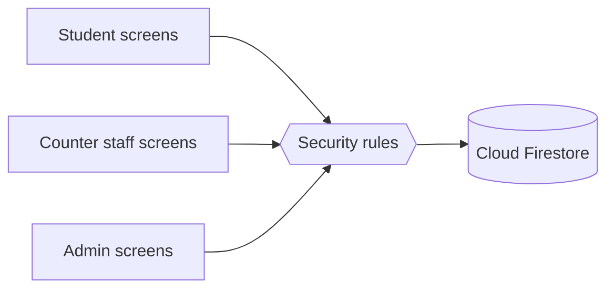

## In numbers

| | |
| --- | --- |
| App code | 58,264 lines of Dart in 207 files |
| Screens | 59 |
| Automated app tests | 594 |
| Attack checks on the database rules | 610 |
| Menu | 284 dishes in 19 categories |
| Roles | 3, plus a TV-screen login |

Counted from the source on 10 November 2026.

## What is next

- A four-week pilot with real students, measuring orders a day, minutes from order to ready, and how many orders are never collected.
- Switching on online payment.
- Alerts when the app is closed.
- The App Store and Play Store.

## About the code

The source code is in a private repository while a pilot is being discussed. We are happy to walk through it: the architecture, the security rules and the tests.

## Notes

- Counter and admin screenshots, the TV board, the tracking screen and the pass show sample orders with made-up names. The browsing screens show the real menu.
- Dish photos are from Unsplash under its licence. Fonts are Sora and Plus Jakarta Sans under the SIL Open Font License.
- QueueLess is a student project. It is not affiliated with or endorsed by any college or canteen.

© 2026 Vansh Dave and Swara Tillu. All rights reserved.
